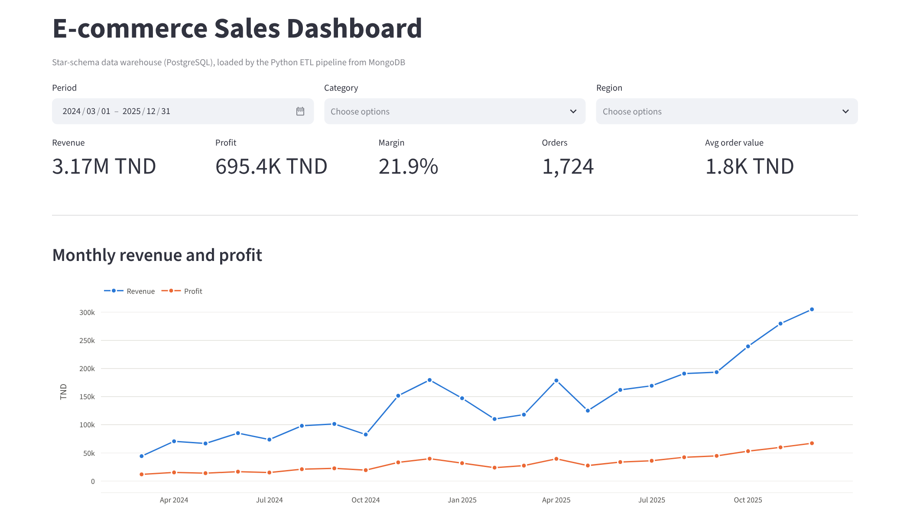
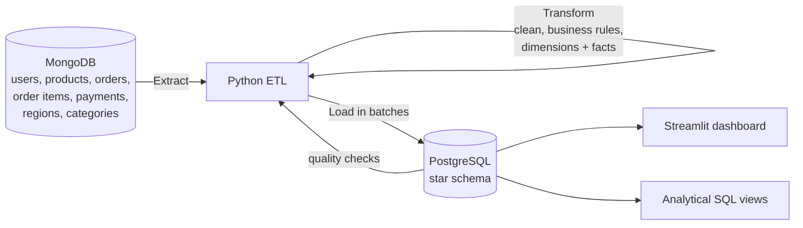
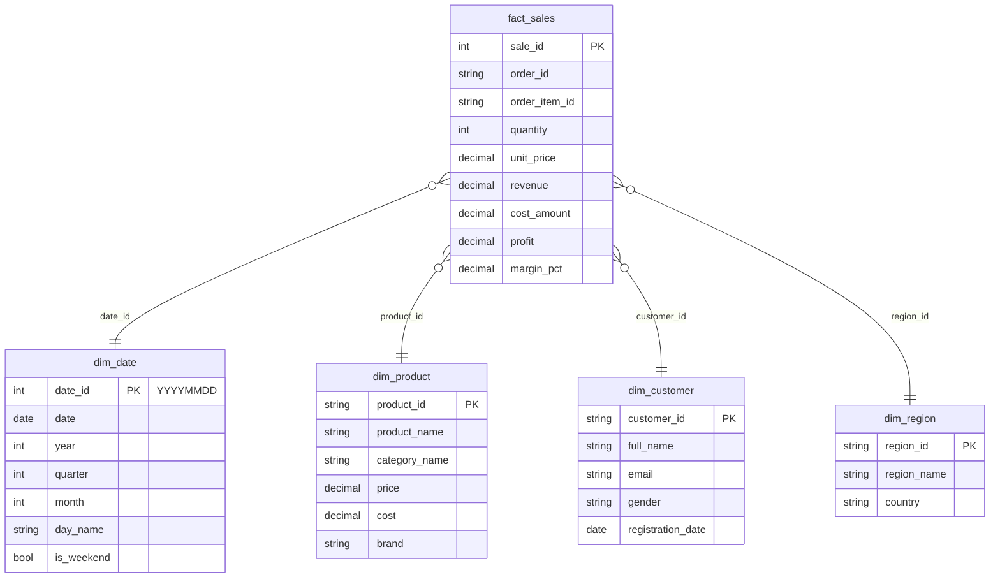
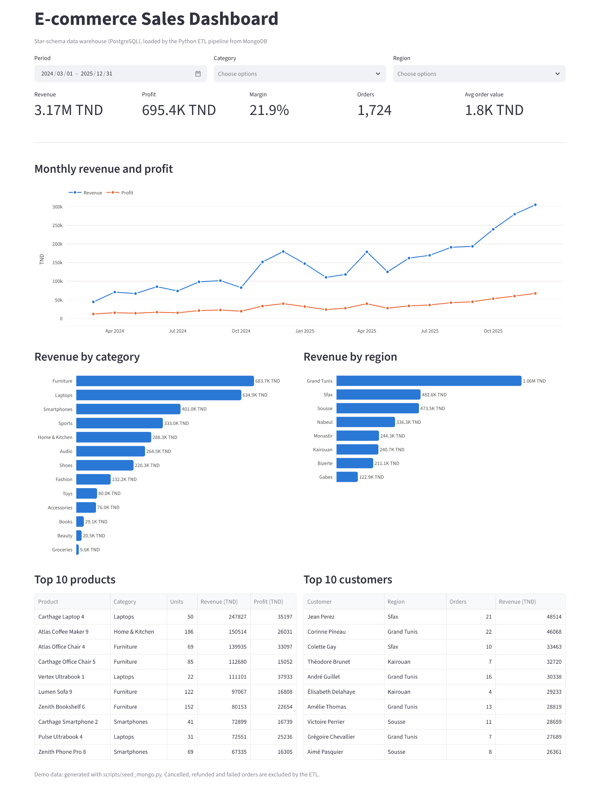

# E-commerce BI – ETL Pipeline, Star-Schema Warehouse and Sales Dashboard

[](https://github.com/Mohamed-jarboui/BI_ETL/actions/workflows/ci.yml)


A complete business intelligence pipeline for an online store: a Python ETL extracts operational data from **MongoDB**, cleans it and applies business rules, loads it into a **PostgreSQL star schema**, and a **Streamlit** dashboard turns it into sales KPIs and trends. Everything runs locally with Docker and a reproducible demo dataset.

Built as a Business Intelligence project during my 5th year of engineering studies.



## Architecture



| Step | What it does |
|---|---|
| **Extract** (`etl/extract.py`) | Reads the 7 MongoDB collections into DataFrames and validates that the critical ones are not empty |
| **Transform** (`etl/transform.py`) | Builds the date, product, customer and region dimensions; joins order items with orders, customers and products; excludes cancelled, refunded and failed orders; computes revenue, cost, profit and margin; drops rows that break referential integrity |
| **Load** (`etl/load.py`) | Truncates and reloads the warehouse (dimensions first, then the fact table in batches), verifies row counts and runs data quality checks |
| **Serve** (`dashboard/app.py`, `sql/schema.sql`) | Streamlit dashboard plus SQL views for sales summary, top products and customer analysis |

## Data warehouse



Grain of `fact_sales`: **one row per order line**. Foreign keys and indexes are defined in [`sql/schema.sql`](sql/schema.sql), along with three analytical views (`vw_sales_summary`, `vw_top_products`, `vw_customer_analysis`).

## Dashboard

KPIs (revenue, profit, margin, orders, average order value), monthly trend, revenue by category and region, and top products and customers, all filterable by period, category and region.



## Results on the demo dataset

`scripts/seed_mongo.py` generates a reproducible store: 420 customers, 180 products in 13 categories, 8 regions and 2,004 orders over March 2024 to December 2025, with growth, a year-end peak and about 14% cancelled or refunded orders. One full ETL run on it:

| | |
|---|---|
| Documents extracted | 10,804 across 7 collections (6,356 order lines) |
| Rows loaded | 5,435 in `fact_sales`, plus 655 dates, 180 products, 420 customers, 8 regions |
| Excluded | 921 order lines from 280 cancelled or refunded orders |
| Quality checks | 4 of 4 passed (no orphan products or dates, no negative revenue, no zero quantities) |
| Run time | about 1.7 s end to end |

The data is fake (names from Faker, amounts in TND), so the dashboard numbers describe the demo store, not a real business.

## Getting started

Requirements: Python 3.10+ and Docker.

```bash
git clone https://github.com/Mohamed-jarboui/BI_ETL.git
cd BI_ETL
cp .env.example .env

python -m venv venv
source venv/bin/activate              # Windows: venv\Scripts\activate
pip install -r requirements.txt

docker compose up -d                  # MongoDB + PostgreSQL (schema created automatically)
python scripts/seed_mongo.py          # load the demo data into MongoDB
python -m etl.main                    # run the ETL
streamlit run dashboard/app.py        # open http://localhost:8501
```

To use your own MongoDB instead, set `MONGO_URI` and `MONGO_DB` in `.env` and check the source with `python scripts/inspect_mongo.py`. Credentials are only read from `.env` (git-ignored) and are masked in the logs.

**Run part of the pipeline**

```bash
python -m etl.main --extract-only
python -m etl.main --skip-load
```

**Check the warehouse**

```bash
docker exec -i ecommerce_dw psql -U bi_admin -d ecommerce_dw < sql/verify_data.sql
```

## Tests

```bash
pytest tests -v
```

- **Unit tests** (`tests/test_transform.py`) run the transformation on generated data: dimension sizes and unique keys, excluded order statuses, revenue / profit / margin formulas, foreign keys, and credential masking.
- **End-to-end test** (`tests/test_integration.py`) seeds MongoDB, runs the full ETL and checks the warehouse. It runs in GitHub Actions against real MongoDB and PostgreSQL containers, or locally with `RUN_INTEGRATION=1` once `docker compose` is up.

## Project structure

```
├── etl/
│   ├── config.py          # settings from .env, logging, credential masking
│   ├── extract.py         # MongoDB -> DataFrames
│   ├── transform.py       # dimensions, fact table, business rules
│   ├── load.py            # PostgreSQL loading, verification, quality checks
│   └── main.py            # pipeline orchestrator (CLI)
├── sql/
│   ├── schema.sql         # star schema, indexes, analytical views
│   └── verify_data.sql    # data quality queries
├── dashboard/app.py       # Streamlit dashboard
├── scripts/
│   ├── seed_mongo.py      # reproducible demo data generator
│   └── inspect_mongo.py   # check source collections and fields
├── tests/                 # unit and end-to-end tests
├── docs/images/           # dashboard screenshots
├── docker-compose.yml     # MongoDB + PostgreSQL
└── .github/workflows/ci.yml
```

## Next steps

- Incremental loads (only new or changed orders) instead of truncate-and-reload
- Slowly changing dimensions (type 2) for product prices and customer regions
- Schedule the pipeline with Airflow or a cron job
- Use the payments collection to add a payment-method dimension
